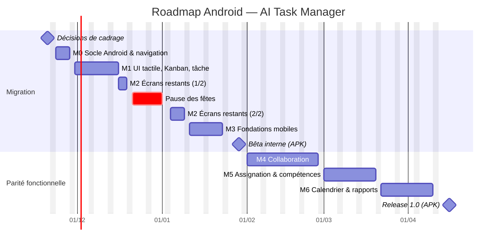

# Roadmap — AI Task Manager Android (Flutter)

Roadmap du client Flutter [ai_task_manager/](../ai_task_manager/), devenu **Android uniquement** le 19/11/2026.

Elle s'appuie sur [PLAN_MIGRATION_MOBILE.md](PLAN_MIGRATION_MOBILE.md) (comment migrer) et sur COMPARAISON_FLUTTER.md (fonctionnalités manquantes).

**Hypothèses de planification :**
- 1 développeur Flutter à temps plein, du lundi au vendredi.
- Pause des fêtes du 21/12/2026 au 01/01/2027 (à confirmer).
- Une marge d'environ 30 % est incluse dans chaque jalon.
- La colonne « Backend » reprend FONCTIONNALITES.md ; elle n'a pas été vérifiée dans le code de `backend/`.

---

## Décisions de cadrage (20/11/2026)

| Sujet | Décision |
|---|---|
| Kanban | Vrai Kanban à colonnes, **sur le modèle de l'application mobile de Trello** : colonnes aimantées, appui long pour déplacer une carte, défilement automatique vers la colonne voisine. |
| OAuth GitHub | **Polling actuel conservé** (navigateur externe + vérification du statut). |
| Notifications push (FCM) | **Après la 1.0.** |
| `applicationId` | **`com.aitaskmanager.mobile`** (définitif dès la première publication sur le Play Store). |
| Distribution | APK signé pour la bêta et la 1.0 ; **Play Store public plus tard.** |

---

## Vue d'ensemble

| Jalon | Période | Objectif | Résultat attendu |
|---|---|---|---|
| **M0** Socle | 23/11 → 27/11 | L'app tourne sur Android | Connexion GitHub OK, navigation en bas |
| **M1** UI tactile | 30/11 → 15/12 | Cœur du produit utilisable au doigt | Kanban style Trello et détail de tâche mobiles |
| **M2** Écrans | 16/12 → 08/01 | Tous les écrans existants adaptés | Parité avec le desktop actuel |
| **M3** Fondations | 11/01 → 22/01 | Fiabilité mobile | Hors ligne, temps réel, reprise après l'arrière-plan |
| 🚀 **Bêta interne** | 25/01 → 29/01 | Distribution à l'équipe | APK signé |
| **M4** Collaboration | 01/02 → 26/02 | Combler les manques principaux | Commentaires, Mes tâches, recherche, images |
| **M5** Assignation | 01/03 → 19/03 | Différenciateur IA | Suggestions, répartition, compétences |
| **M6** Calendrier & rapports | 22/03 → 09/04 | Parité complète | Calendrier et rapports par période |
| 🎯 **Release 1.0** | 12/04 → 16/04 | Version stable | APK de production |
| **Après 1.0** | à planifier | Ouverture au public | Push FCM, publication Play Store |

---

## Phase 1 — Migration Android

### M0 — Socle Android et navigation *(23/11 → 27/11)*

- [ ] Générer `android/` (`fvm flutter create --platforms=android`), avec `applicationId` et `namespace` fixés à `com.aitaskmanager.mobile`.
- [ ] Supprimer `windows/`, `macos/` et la dépendance `window_manager`.
- [ ] Permission `INTERNET`, configuration cleartext limitée au dev, `<queries>` pour `url_launcher`.
- [ ] `API_BASE_URL` par `--dart-define` (émulateur : `10.0.2.2`).
- [ ] Retirer `prefs.clear()` de [main.dart](../ai_task_manager/lib/main.dart) pour que la session persiste.
- [ ] Orientation portrait, `SafeArea`, edge-to-edge.
- [ ] Navigation en bas (`StatefulShellRoute`) : Dashboard admin, Projets, Messages, Notifications, Profil, avec badges.
- [ ] Routes plein écran pour le board et la conversation ; bouton retour Android.

**Terminé quand :** l'app se lance sur l'émulateur et sur un vrai téléphone, la connexion GitHub aboutit, la session survit à un redémarrage et tous les onglets s'ouvrent.

### M1 — UI tactile, Kanban et détail de tâche *(30/11 → 15/12)*

- [ ] Design system : retour visuel au toucher à la place du survol, cibles de 44–48 px, `AppDialog` remplacé par des bottom sheets.
- [ ] Choisir entre le package `appflowy_board` et une version maison (`LongPressDraggable` / `DragTarget`), dès les 2 premiers jours.
- [ ] **Kanban style Trello :**
  - [ ] Colonnes d'environ 85 % de la largeur, défilement horizontal aimanté, aperçu de la colonne suivante, indicateur de position.
  - [ ] En-tête de colonne : statut et nombre de cartes.
  - [ ] Cartes : labels en couleur, identifiant, titre, échéance, avatar de l'assigné.
  - [ ] Appui long pour saisir une carte (retour haptique), dépôt à une position précise (`order`).
  - [ ] Défilement automatique vers la colonne voisine au bord de l'écran, et vertical dans une colonne longue.
  - [ ] « + Ajouter une tâche » en bas de chaque colonne.
  - [ ] Cartes non déplaçables pour qui n'est ni admin ni assigné, avec message à l'appui long.
  - [ ] Filtres de priorité en chips défilantes.
- [ ] Détail de tâche en page plein écran (`/board/:projectId/task/:taskId`), avec barre d'enregistrement fixe et sélecteur de statut.
- [ ] Sélecteur d'assigné en bottom sheet avec recherche.

**Terminé quand :** sur un écran de 360 px, on peut créer une tâche, la déplacer d'« À faire » à « Terminé » par glisser-déposer, la réordonner dans sa colonne, la modifier et l'assigner.

### M2 — Écrans restants *(16/12 → 18/12, puis 04/01 → 08/01)*

- [ ] Projets : liste en 1 colonne, FAB de création, création en plein écran, tirer pour rafraîchir.
- [ ] **Édition de projet** (le service existe déjà).
- [ ] Messages : gestion du clavier, scroll vers le dernier message, bulles à environ 80 %.
- [ ] Notifications : tirer pour rafraîchir, glisser pour marquer comme lu.
- [ ] Profil : thème, déconnexion, entrées admin, **édition du profil**.
- [ ] Admin : fusion de Team et Admin en un écran « Équipe » ; vue d'ensemble empilée ; page « Membres » du projet.
- [ ] Planification IA : accès depuis le projet (l'écran était inaccessible), import de fichier `.txt` / `.md`, aperçu dépliable, barre Approuver / Rejeter.

**Terminé quand :** chaque écran du desktop a son équivalent mobile, sans débordement de mise en page à 360 px ni avec un texte agrandi à 130 %.

### M3 — Fondations mobiles *(11/01 → 22/01)*

- [ ] Cycle de vie : reconnexion du socket au premier plan et rechargement des messages manqués.
- [ ] **Polling OAuth robuste :** reprise de la vérification au retour dans l'app (`AppLifecycleListener`).
- [ ] Hors ligne : affichage du cache Drift, bandeau « hors ligne », écritures désactivées sans réseau.
- [ ] Temps réel étendu au **Kanban** et aux **notifications** (événements Socket.IO).
- [ ] Compteur de messages non lus **persisté côté serveur**.
- [ ] JWT stocké dans `flutter_secure_storage`.
- [ ] Tests widget des parcours critiques (connexion, Kanban, détail de tâche, envoi de message).

**Terminé quand :** l'app passe en arrière-plan, revient, perd puis retrouve le réseau sans incohérence de données.

### 🚀 Bêta interne *(25/01 → 29/01)*

- [ ] Keystore de signature créé et **sauvegardé hors dépôt** (il servira aussi pour le Play Store).
- [ ] Build `release`, APK distribué à l'équipe.
- [ ] Icône et nom de l'app, écran de démarrage.
- [ ] Remontée des crashs (ex. Firebase Crashlytics ou Sentry).
- [ ] Collecte des retours, en particulier sur le glisser-déposer du Kanban, et triage avant M4.

---

## Phase 2 — Parité fonctionnelle

Fonctionnalités de FONCTIONNALITES.md absentes de Flutter, par ordre de valeur.

### M4 — Collaboration *(01/02 → 26/02)*

| Fonctionnalité | Détail | Backend |
|---|---|---|
| Commentaires de tâches | Liste, ajout et suppression dans le détail de tâche | Existant |
| Notifications de commentaires | Nouveau type `commentAdded` | Existant |
| Page « Mes tâches » | Membre : ses tâches ; admin : toutes | Existant |
| Recherche | Icône de recherche dans l'en-tête (équivalent mobile de `Ctrl+K`) : tâches, projets, membres | Existant |
| Filtres et tri | Projet, priorité, avancement ; tri par échéance, priorité, activité ; pagination infinie | Existant |
| Image de tâche | Appareil photo ou galerie (`image_picker`), upload, suppression | Existant |
| Groupes de discussion | Création de conversations de groupe | Existant |

### M5 — Assignation intelligente et compétences *(01/03 → 19/03)*

| Fonctionnalité | Détail | Backend |
|---|---|---|
| Suggestions d'assigné | Liste triée par score dans le sélecteur d'assigné | Existant |
| Répartition automatique | Prévisualisation puis application, à l'échelle du projet (admin) | Existant |
| Compétences utilisateur | Ajout, niveau, suppression dans le profil | Existant |
| Catalogue de compétences et de labels | Gestion admin ; labels choisis dans le catalogue | Existant |
| Raffinement du plan IA | Modification manuelle et instructions complémentaires | Existant |

### M6 — Calendrier et rapports *(22/03 → 09/04)*

| Fonctionnalité | Détail | Backend |
|---|---|---|
| Calendrier | Vue mois / agenda des échéances et des événements | Existant |
| Événements | Création, projet associé, visibilité, suppression par le créateur | Existant |
| Rapports | Par période (jour / semaine / mois), tâches terminées dans le temps, top contributeurs, répartition par priorité | Endpoint de statistiques recommandé (la vue d'ensemble calcule aujourd'hui tout côté client) |
| Intégration GitHub | Création de branche depuis une tâche, création de dépôt à la création du projet | Existant |

### 🎯 Release 1.0 *(12/04 → 16/04)*

- [ ] Gel des fonctionnalités, campagne de tests sur 2 ou 3 appareils réels (petit écran, Android ancien, Android récent).
- [ ] APK de production signé, distribué en direct.
- [ ] Mise à jour de FONCTIONNALITES.md (« application mobile Android »).

---

## Après la 1.0 — à planifier

### Notifications push (FCM) *(environ 2 semaines)*

- [ ] Projet Firebase, `firebase_messaging`, canal de notification Android.
- [ ] Enregistrement du token FCM après connexion ; suppression à la déconnexion.
- [ ] Ouverture de la tâche ou de la conversation au tap sur la notification.
- [ ] Préférences de notifications (activer / désactiver par type).
- **Backend :** envoi FCM sur assignation, changement de statut, commentaire et message, et stockage des tokens. **À développer.**

### Publication Play Store public *(environ 1 semaine, hors délai de revue Google)*

- [ ] Compte développeur Google Play, vérification de la disponibilité de `com.aitaskmanager.mobile`.
- [ ] Play App Signing avec le keystore existant, build App Bundle (`.aab`).
- [ ] `targetSdk` conforme à l'exigence Google en vigueur.
- [ ] Fiche Play Store : description, captures, icône, catégorie.
- [ ] Politique de confidentialité publiée, formulaire « Sécurité des données ».
- [ ] Piste de test fermée (Google peut exiger un nombre minimal de testeurs pendant 14 jours pour un nouveau compte personnel), puis production.

---

## Dépendances backend

| Besoin | Jalon | Statut |
|---|---|---|
| Événements Socket.IO pour le Kanban et les notifications | M3 | À vérifier côté backend |
| Compteur de non-lus / accusé de lecture | M3 | Annoncé dans la doc, à brancher |
| Endpoint de statistiques agrégées | M6 | Recommandé |
| Envoi de push FCM et stockage des tokens | Après 1.0 | À développer |

## Risques

| Risque | Impact | Parade |
|---|---|---|
| Glisser-déposer entre colonnes délicat sur petit écran | Jalon M1 qui déborde | Choix `appflowy_board` / maison en début de M1 ; sélecteur de statut dans le détail en secours |
| Polling OAuth interrompu en arrière-plan | Connexion qui échoue | Reprise au premier plan (M3) |
| Pas de push avant l'après-1.0 | Aucune alerte quand l'app est fermée | Badges et temps réel à l'ouverture ; push en priorité après la 1.0 |
| Perte du keystore de signature | Impossible de mettre à jour l'app publiée | Sauvegarde hors dépôt dès la bêta, Play App Signing |
| Vue d'ensemble admin coûteuse sur réseau mobile | Lenteur, consommation de données | Endpoint de statistiques (M6) |
| Régénération de code (`build_runner`) à chaque changement de modèle | Ralentissements si oubliée | Lancement manuel, à signaler à chaque fois |
| Couverture de tests quasi nulle (un seul test) | Régressions pendant la migration | Tests des parcours critiques dès M3 |
| Pause des fêtes | Décalage de M2 | Planning déjà ajusté ; M2 coupé en deux |
